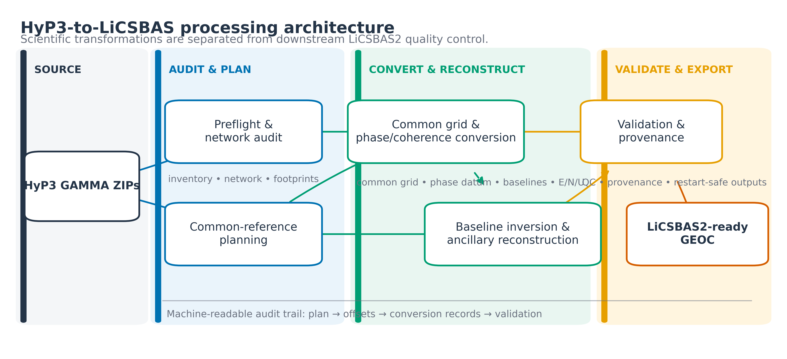
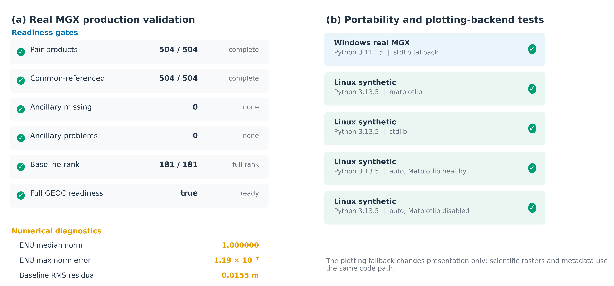

# HyP3-to-LiCSBAS

[](https://github.com/xbdqs/HyP3-to-LiCSBAS/actions/workflows/ci.yml)
[](LICENSE)
[](pyproject.toml)

**HyP3-to-LiCSBAS** is a cross-platform Python adapter that converts **ASF HyP3 GAMMA Sentinel-1 InSAR** products into a **LiCSBAS2-ready `GEOC` stack**. The software addresses scientific-semantic differences that cannot be resolved by file renaming alone: interferogram-specific phase references, pairwise perpendicular baselines, heterogeneous footprints, LOS geometry, ancillary layers, metadata, provenance, and validation.

<p align="center">
  
</p>

## Why this adapter exists

HyP3 and LiCSBAS2 use compatible scientific quantities but organize and reference them differently. A robust conversion therefore needs to preserve the meaning of the data, not only the filenames. HyP3-to-LiCSBAS performs four main tasks:

1. **Harmonizes phase references** across independently referenced HyP3 interferograms.
2. **Reconstructs acquisition-level perpendicular baselines** from redundant pairwise observations.
3. **Builds LiCSBAS-compatible ancillary geometry**, including MLI, DEM, and LOS E/N/U layers.
4. **Writes provenance and validation records** so the conversion can be audited and resumed.

The adapter prepares inputs for LiCSBAS2. It does **not** replace downstream LiCSBAS interferogram screening, loop-closure analysis, masking, inversion, or final stable-reference selection.

## Supported input

Current scope:

- ASF HyP3 GAMMA Sentinel-1 full-granule InSAR products
- INT40 and INT80 products
- unwrapped phase and coherence as the core required rasters
- optional amplitude, DEM, look-vector and incidence-angle rasters for a complete ancillary package

ARIA-S1 GUNW and burst products are outside the current scope.

## Quick start

### 1. Clone

```bash
git clone https://github.com/xbdqs/HyP3-to-LiCSBAS.git
cd HyP3-to-LiCSBAS
```

### 2. Install

Using pip in a clean Python environment:

```bash
python -m pip install --upgrade pip
python -m pip install -e .
python check_env.py
```

Optional plotting and manuscript-figure support:

```bash
python -m pip install -e ".[plot]"
```

Windows users may instead use `SETUP_WINDOWS.bat`; Linux/WSL users may use `setup_linux.sh`.

### 3. Inspect the stack

```bash
python hyp3lics.py preflight -i /path/to/HyP3 -o /path/to/preflight
```

### 4. Build a common-reference plan

```bash
python hyp3lics.py plan -i /path/to/HyP3 -o /path/to/plan
```

### 5. Prepare the LiCSBAS2 stack

```bash
python hyp3lics.py prepare \
  -i /path/to/HyP3 \
  -o /path/to/HyP3_LiCSBAS \
  --plan-dir /path/to/plan \
  --extent-mode intersection \
  --plot-backend auto
```

Existing `*.geo.unw.tif` and `*.geo.cc.tif` outputs are reused unless `--overwrite` is supplied, so interrupted conversions can be resumed safely.

See **[docs/quickstart.md](docs/quickstart.md)** for Windows and Linux/WSL examples.

## Output structure

```text
OUTPUT/
├── GEOC/
│   ├── metadata.txt
│   ├── baselines
│   ├── network.png
│   ├── <stack>.geo.mli.tif
│   ├── <stack>.geo.hgt.tif
│   ├── <stack>.geo.E.tif
│   ├── <stack>.geo.N.tif
│   ├── <stack>.geo.U.tif
│   └── YYYYMMDD_YYYYMMDD/
│       ├── YYYYMMDD_YYYYMMDD.geo.unw.tif
│       └── YYYYMMDD_YYYYMMDD.geo.cc.tif
├── _hyp3lics/
│   ├── validation.json
│   ├── master_grid.json
│   ├── reference_plan.json
│   ├── reference_offsets.csv
│   ├── baseline_inversion_summary.json
│   ├── baseline_pair_residuals.csv
│   └── ancillary_provenance.json
└── NEXT_LICSBAS2.txt
```

## Scientific transformations

### Common phase reference

HyP3 products may use different phase-reference locations for different interferograms. The adapter selects one common high-coherence reference window and applies an additive phase shift to every interferogram before LiCSBAS2 analysis. This establishes a common network datum; it does not correct atmospheric delay, decorrelation or unwrapping errors.

### Perpendicular baselines

For every interferometric pair, HyP3 provides a pairwise perpendicular baseline. The adapter solves

```text
b_secondary - b_reference = B_pair
```

over the connected network with one acquisition fixed as the zero datum. Pair residuals are written to `baseline_pair_residuals.csv` as an internal network-consistency diagnostic.

### LOS geometry

For HyP3 look-vector elevation `theta` and orientation `phi`, the Cartesian components are

```text
E = cos(theta) * cos(phi)
N = cos(theta) * sin(phi)
U = sin(theta)
```

E/N/U are computed **before reprojection** on the native HyP3 grid. The Cartesian components are then bilinearly reprojected and renormalized. This avoids directly interpolating the periodic `phi` angle across its `-pi/+pi` branch cut.

More detail is provided in **[docs/scientific-method.md](docs/scientific-method.md)**.

## Production validation

A real Sentinel-1A ascending stack was used as a production-scale validation case:

| Metric | Result |
|---|---:|
| Interferograms | 504 |
| Acquisitions | 182 |
| Time span | 2019-12-26 to 2025-12-30 |
| Relative orbit | 166 |
| Connected components | 1 |
| Triangular loops | 470 |
| Cycle rank | 323 |
| Common-referenced interferograms | 504 / 504 |
| Baseline inversion rank | 181 / 181 |
| Baseline residual RMS | 0.0155 m |
| ENU median vector norm | 1.0 |
| Maximum absolute ENU norm error | 1.19e-07 |
| Final GEOC structural validation | PASS |

The baseline residual measures **internal consistency** of the redundant baseline network. The ENU norm check is a **numerical structural check**, not an independent external validation of absolute viewing geometry.

See **[MGX_PRODUCTION_VALIDATION.md](MGX_PRODUCTION_VALIDATION.md)** and **[docs/validation.md](docs/validation.md)**.

<p align="center">
  
</p>

## Tests and continuous integration

The repository includes:

- `tests/test_look_vector_branchcut.py` — regression test for the `phi` branch cut;
- `tests/test_synthetic_zip_stack.py` — synthetic HyP3 ZIP stack test;
- `tests/test_end_to_end_crossplatform.py` — complete synthetic GEOC generation and plotting-backend test.

GitHub Actions runs core tests on Windows and Linux and the complete end-to-end test on Linux. See the **Actions** tab for the current status.

Run locally:

```bash
python tests/test_look_vector_branchcut.py
python tests/test_synthetic_zip_stack.py
python tests/test_end_to_end_crossplatform.py
```

## Paper figure reproduction

`paper/` contains compact derived CSV data, six standalone plotting scripts, and preview PNGs for the manuscript figures. The multi-gigabyte source HyP3 raster stack is not redistributed.

```bash
python -m pip install -e ".[plot]"
python paper/figures/plot_figure_01.py
```

See **[paper/README.md](paper/README.md)**.

## LiCSBAS2 handoff

For a native-posting GEOC stack:

```bash
LiCSBAS02_ml_prep.py -i GEOC -n 1
```

Then continue with the standard LiCSBAS2 quality-control and time-series workflow.

## Documentation

- [Quick start](docs/quickstart.md)
- [Scientific method](docs/scientific-method.md)
- [Validation and interpretation](docs/validation.md)
- [Contributing](CONTRIBUTING.md)
- [Citation](CITATION.md)
- [Changelog](CHANGELOG.md)

## Citation

If you use this software, please cite the repository metadata in `CITATION.cff`. A journal citation can be added after publication of the associated SoftwareX article.

## Author

**Qingsong Du**

## License

MIT License. See [LICENSE](LICENSE).
